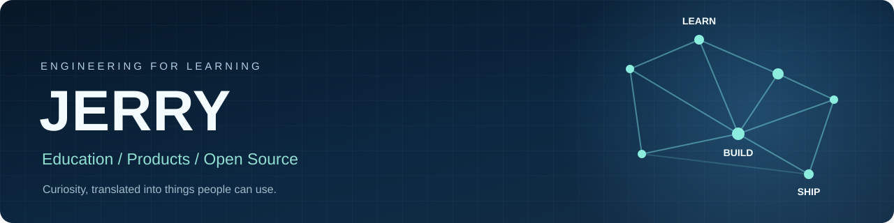

  

  <h1>Hi, I'm Jerry.</h1>

  
<strong>STEM educator · Self-taught software developer · Product builder</strong>

  
From chemical engineering to software engineering — building practical tools for learning and real-world operations.

  
<a href="#selected-projects">Explore my projects</a> · <a href="#what-im-exploring">What I'm working on</a> · <a href="https://github.com/jerry200176-png">GitHub</a>

---

### About me

I'm based in Taiwan and have a background in **Chemical Engineering at National Taiwan University**. Alongside teaching mathematics and science, I taught myself to build software and started turning everyday problems into products.

My interests sit at the intersection of **education, product engineering, and AI-assisted development**. I care less about adding features for their own sake and more about whether a tool helps someone learn, work, or make better decisions.

- **Education:** Explaining scientific ideas through first principles, interactive models, and focused practice.
- **Product:** Designing workflows around actual users — teachers, students, parents, and operators.
- **Engineering:** Building maintainable systems with automated testing, clear release evidence, and careful production changes.

> **中文簡介：** 台大化工背景、自學軟體開發的 STEM 教育工作者。我關注如何用可靠、好用的數位工具，讓學習更直觀，也讓日常營運更有效率。

### Selected projects

<table>
<tr>
<td width="50%" valign="top">

<h3><a href="https://github.com/jerry200176-png/AllTrue_System">AllTrue</a></h3>

An operations platform for multi-campus tutoring centers, bringing scheduling, attendance, learning records, billing, and parent communication into one workflow.

<code>Vue 3</code> <code>Laravel</code> <code>MySQL</code> <code>GitHub Actions</code>

<a href="https://github.com/jerry200176-png/AllTrue_System">View repository →</a>

</td>
<td width="50%" valign="top">

<h3><a href="https://github.com/jerry200176-png/sunrise-cafe">Sunrise Cafe</a></h3>

A reservation and operations system for a café, covering room bookings, LINE-based deposit workflows, and an administrative dashboard.

<code>Next.js</code> <code>TypeScript</code> <code>Supabase</code> <code>LINE API</code>

<a href="https://github.com/jerry200176-png/sunrise-cafe">View repository →</a>

</td>
</tr>
</table>

### What I'm exploring

**Sun Lab — interactive solar motion learning**  
A browser-based 3D teaching prototype for exploring the Sun's apparent path, seasons, latitude, daylight, and Earth's axial tilt. *In development; public demo and source repository are not yet linked.*

**Open educational tools**  
I'm interested in curriculum-aligned STEM learning experiences, concept maps, science simulations, and Traditional Chinese localization for learners in Taiwan.

### Tools used across my projects

`TypeScript` · `JavaScript` · `Python` · `Vue` · `Next.js` · `Laravel` · `Three.js` · `MySQL` · `PostgreSQL / Supabase` · `GitHub Actions`

My development workflow uses AI agents for implementation and review, with human judgment and evidence-based checks for correctness, security, and release readiness.

---

  <strong>Build to understand. Test to trust. Improve to help.</strong>
   
  Based in Taiwan · Open to thoughtful collaboration on education and developer tools
    
  <a href="https://github.com/jerry200176-png">GitHub profile</a>

